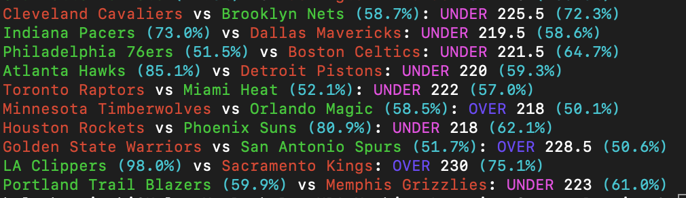
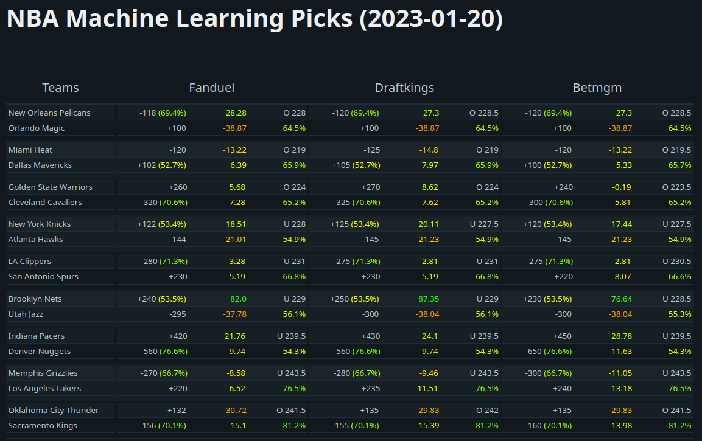

# NBA Sports Betting Using Machine Learning


## Overview
This project predicts NBA game winners and totals (over/under) using team stats and sportsbook odds. It pulls team data from 2007-08 through the current season, builds matchup features, and runs trained models to estimate win probabilities and totals outcomes. It also outputs expected value and optional Kelly Criterion stake sizing.

## Features
- Moneyline and totals predictions (XGBoost and Neural Net models).
- Expected value calculation and optional Kelly Criterion sizing.
- Odds ingest from supported sportsbooks or manual input.
- Data processing pipeline and model training scripts.
- Flask web app for browsing outputs.

## How it works
1. **Collect stats and odds**: `Get_Data` pulls daily team stats from NBA endpoints and stores them in SQLite. `Get_Odds_Data` pulls sportsbook odds and scores from SBR and stores them in a separate SQLite DB.
2. **Collect player + availability signals**: `Get_Player_Data` imports individual player game logs from the public SportsDataverse/ESPN archive or the NBA endpoint. It stores stable team/player IDs, opponents, tip times, starter/DNP context, positions, box scores, provenance, and immutable optional injury/lineup/roster snapshots in `Data/PlayerData.sqlite`.
3. **Build game features**: `Create_Games` merges team stats, odds, scores, days-rest, and home/away player, injury, and lineup aggregates into a training dataset.
4. **Train models**: XGBoost/NN scripts in `src/Train-Models` fit moneyline and totals models.
5. **Predict today**: `main.py` fetches today’s schedule, builds matchup features, loads trained models, and prints predictions, expected value, and optional Kelly Criterion sizing.

## Requirements
- Python 3.11
- Packages: Tensorflow, XGBoost, NumPy, Pandas, Colorama, Tqdm, Requests, Scikit-learn

Install dependencies:
```bash
pip3 install -r requirements.txt
```

## Quick start
```bash
python3 main.py -xgb -odds=fanduel
```

Odds will be fetched automatically when `-odds` is provided. Supported books:
`fanduel`, `draftkings`, `betmgm`, `pointsbet`, `caesars`, `wynn`, `bet_rivers_ny`

If `-odds` is omitted, the script will prompt for manual odds and totals.

Schedule discovery uses the current NBA scoreboard with a date-specific ESPN fallback when NBA requests are blocked or return invalid data. If both feeds fail, the command reports that the schedule is unavailable and stops without generating predictions. A schedule fallback does not supply missing sportsbook prices.

Optional flags:
- `-nn` run neural network model
- `-xgb` run XGBoost model
- `-A` run all models
- `-kc` show Kelly Criterion bankroll fraction

## Flask web app


```bash
cd Flask
flask --debug run
```

The optional roster and player-profile modals need a RapidAPI key. Copy `.env.example` to `.env`, set `RAPIDAPI_KEY`, and load it through your shell or deployment environment before starting Flask. The prediction board, data pipeline, and live NBA availability reports do not use this key.

## Data pipeline and training
```bash
# Run these from the repository root
python src/Process-Data/Update_Data.py
python src/Process-Data/Get_Data.py
python src/Process-Data/Get_Odds_Data.py
python src/Process-Data/Get_Player_Data.py --provider archive --backfill
python src/Process-Data/Get_Player_Data.py --status
python src/Process-Data/Create_Games.py

# Train models
python src/Train-Models/XGBoost_Model_ML.py --dataset dataset_2012-26_player_v2 --trials 100 --splits 5 --calibration sigmoid
python src/Train-Models/XGBoost_Model_UO.py --dataset dataset_2012-26_player_v2 --trials 100 --splits 5 --calibration sigmoid
python src/Train-Models/NN_Model_ML.py --dataset dataset_2012-26_player_v2
python src/Train-Models/NN_Model_UO.py --dataset dataset_2012-26_player_v2
python src/Train-Models/Logistic_Regression_ML.py --dataset dataset_2012-26_player_v2 --trials 50 --splits 5 --calibration sigmoid
python src/Train-Models/Logistic_Regression_UO.py --dataset dataset_2012-26_player_v2 --trials 50 --splits 5 --calibration sigmoid
```

The XGBoost trainers use separate, player-data-focused search ranges for moneyline and totals. They write every candidate to `Models/XGBoost_Models`, record each held-out result in `model_candidates.json`, and promote a candidate in `selected_models.json` only when its test log loss improves on the selected model trained from the same dataset. `main.py` loads the promoted model.

To test one exact parameter set instead of a random search, pass JSON directly or provide a JSON file:

```bash
python src/Train-Models/XGBoost_Model_ML.py --dataset dataset_2012-26_player_v2 --fixed-params '{"max_depth":5,"eta":0.035,"subsample":0.82,"colsample_bytree":0.72,"min_child_weight":10,"gamma":2,"max_delta_step":3,"lambda":1.5,"alpha":0.25,"num_boost_round":1000}'
```

For totals, the rare push class is retained but uses a lighter training weight (`--push-weight 0.25`) so it does not overwhelm the over/under objective.

### One-command data updates

Use the coordinator for normal updates. It identifies the active season, or the most recently completed season during the offseason, fills missing team and FanDuel odds dates, refreshes player logs and live availability reports, then rebuilds the player-aware dataset:

```bash
python src/Process-Data/Update_Data.py
```

To repair gaps across every configured season, run:

```bash
python src/Process-Data/Update_Data.py --all-history
```

Useful options include `--season 2025-26`, `--sportsbook draftkings`, `--reports-only`, `--skip-dataset`, and `--dry-run`. Historical odds are only as complete as the selected sportsbook's SBR archive; the command leaves dates with no returned board missing so they can be retried later. For 2026–27, the configured consensus fallback imports score-validated closing totals and spreads when SBR boards are unavailable. It does not supply executable moneyline payout prices; those remain missing until a sportsbook price source is added.

`Create_Games` writes `dataset_2012-26_player_v2` by default. The current local database contains the 2012–13 through 2025–26 player archive and the built v2 game dataset. Use `--output-table <name>` to override.

### Normalized game storage

`Data/NBAData.sqlite` is the canonical store for `team_snapshots`, `games`, and `odds_quotes`. New team and odds ingestion writes there automatically; `Create_Games` reads it first and falls back to legacy date/season tables only when canonical data is absent. The existing local data has been migrated. To repeat an idempotent migration after importing legacy tables, run:

```bash
python src/Process-Data/Migrate_Normalized_Data.py
```

The included player-aware XGBoost candidates use 196 moneyline and 197 totals features, each with a persisted sigmoid calibrator. Their latest chronological test-block results are 64.39% accuracy / 0.6197 log loss for moneyline and 50.38% accuracy / 0.7320 log loss for totals. These are model-selection diagnostics, not proof of betting profitability; evaluate against timestamped executable prices before wagering.

Live adapters are configured in `config.toml`:

- `player-injuries` retrieves the latest official NBA injury-report PDF for the slate, checking the published report times.
- `player-lineups` retrieves the NBA daily lineup feed and records the first five listed players as its current starter list, with the feed's confirmed/projected status.
- `player-rosters` stores every player in that same daily game feed as a game-day roster snapshot.

`main.py` refreshes all three immediately before it builds predictions. You can also refresh them without fetching game logs:

```bash
python src/Process-Data/Get_Player_Data.py --reports-only
```

Run that command again after a new official injury report or lineup update. The pipeline stores every distinct timestamped snapshot together with its original source response, URL, SHA-256 hash, content type, and parser version. It never converts a missing feed into a healthy or complete team. `primary_url`, `secondary_url`, and `json_path` remain available as provider overrides or local report inputs.

Reports must be timestamped JSON with `game_date`, timezone-aware `published_at`, `records`, and `complete_teams`. An empty `complete_teams` list means coverage is unknown. Import a saved report with:

```bash
python src/Process-Data/Get_Player_Data.py --reports-only --report-json report.json --kind injuries
```

If a report is not yet published or a team has not submitted one, the affected coverage stays `0.0`; player-rotation estimates are then provisional. Newly trained XGBoost and NN models save a `<model>_features.json` sidecar; prediction refuses legacy models without the exact v2 feature contract.

`[bet-eligibility]` is configured to issue **no bet** unless both teams have complete, fresh injury and game-day roster coverage plus five confirmed starters. This intentionally defers a prediction when the live information needed to price player availability is not yet known.

Report download status (`updated`) means a source was fetched successfully; it does not mean every team's availability is complete. The CLI prints a separate `PASS` with the missing inputs for each affected matchup and continues with eligible games. `Expected` starters count as projected, not confirmed. A daily feed containing only five starters is not a complete roster; those games remain on PASS until a complete roster source is supplied. To use a provider-neutral full-roster JSON source, set `[player-rosters].adapter` to `""` and configure `primary_url` or `json_path` using the report contract above.

### Neural network notes
- The NN training scripts default to `dataset_2012-26_player_v2`.
- They save models into `Models/` with timestamped names plus feature sidecars for prediction-time alignment.

### Backfilling missing data
Get_Data normally fetches only new dates in the current season. To fill missing dates:
```bash
cd src/Process-Data
python -m Get_Data --backfill
```

To backfill a single season:
```bash
cd src/Process-Data
python -m Get_Data --backfill --season 2025-26
```

### Backfilling odds data
Get_Odds_Data normally fetches only new dates in the current season. To fill missing odds dates:
```bash
cd src/Process-Data
python -m Get_Odds_Data --backfill
```

To backfill a single season:
```bash
cd src/Process-Data
python -m Get_Odds_Data --backfill --season 2025-26
```

## Contributing
Contributions are welcome. If you change model behavior or data pipelines, add a note in the README and update any related scripts or docs.

### Reproducible model evaluation

New XGBoost runs reserve whole game dates from `2025-10-01` onward as a fixed final evaluation period. Hyperparameter selection and calibration use only earlier games. Each saved model now has an adjacent `<model>_experiment.json` report containing the exact dataset SHA-256 fingerprint, date boundaries, cross-validation result, final accuracy/log loss, Brier score, calibration table, and (for moneyline) an archived-quote market comparison plus a one-unit EV backtest.

```bash
python src/Train-Models/XGBoost_Model_ML.py --dataset dataset_2012-26_player_v2 --trials 100 --splits 5 --calibration sigmoid
python src/Train-Models/XGBoost_Model_UO.py --dataset dataset_2012-26_player_v2 --trials 100 --splits 5 --calibration sigmoid
```

Use `--final-start YYYY-MM-DD` only to begin a new documented evaluation cycle; all candidates within a cycle must keep the same date. Model promotion compares candidates only when their dataset fingerprint, final period, and calibration method match. The moneyline report labels stored historical quote timing as unknown and does not report closing-line value. Capturing timestamped odds from several books is still required before treating a backtest as executable betting evidence.

### Profit-aware moneyline defaults

The moneyline trainer now defaults to `binary:logistic`, uses a 730-day training-weight half-life, and searches a more conservative tree/regularization range. It reserves separate pre-final date blocks for model fitting, probability calibration, and choice of the betting rule. On the policy block, it compares EV thresholds of 2%, 3%, 5%, and 7% with side-probability thresholds of 54%, 56%, 58%, and 60%; it requires at least 50 archived bets before adopting a rule. If no rule qualifies, it uses 2% EV and 54% probability.

```bash
./env/bin/python src/Train-Models/XGBoost_Model_ML.py \
  --dataset dataset_2012-26_player_v2 \
  --trials 100 \
  --splits 5 \
  --calibration sigmoid
```

Use `--recency-half-life-days 0` to compare against unweighted history, `--objective multi:softprob` to compare the previous two-class objective, or change one named setting at a time. The totals trainer has the same recency and calibration-window controls; continue to compare its `--push-weight` values separately because it has no archived payout prices yet.

### Frozen baselines and backtesting changes

Use the dedicated moneyline benchmark to compare changes on the **same games,
archived prices, date split, and betting rule**. It saves a calibrated logistic
regression baseline, a training-only home-win-rate benchmark, and a no-vig market
benchmark. XGBoost candidates and external model predictions use the same evaluator.
It does not change the production model registry.

```bash
# Create once: fit before October 2025, evaluate the 2025–26 season.
./env/bin/python -m src.Evaluation.backtest baseline \
  --name baseline-2025-26-v1 --start 2025-10-01 --end 2026-06-30

# Compare a new model using the frozen data and prices.
./env/bin/python -m src.Evaluation.backtest run \
  --name xgboost-v1 --baseline Data/Backtests/baseline-2025-26-v1 \
  --model xgboost

# Measure whether the player feature group helps; quote the wildcard.
./env/bin/python -m src.Evaluation.backtest run \
  --name logistic-without-players --baseline Data/Backtests/baseline-2025-26-v1 \
  --drop-feature 'H_PLR_*' --drop-feature 'A_PLR_*'

# Display the differences again later.
./env/bin/python -m src.Evaluation.backtest compare \
  Data/Backtests/baseline-2025-26-v1 Data/Backtests/xgboost-v1
```

Each directory contains `report.json`, `summary.md`, a per-game `predictions.csv`
(including BET/PASS, prices, EV, stake, profit and cumulative profit), and the fitted
`model.joblib`. The baseline also contains a frozen dataset, prices and integrity
manifest. Run names cannot overwrite previous results. Local run outputs are ignored
by Git; retain or copy the entire baseline directory when sharing an experiment.

By default, fitting reserves the last 10% of **training dates/rows rounded to whole
dates** for sigmoid calibration; no model fitting or calibration uses evaluation
outcomes. The evaluation uses a fixed 2% minimum expected return and flat one-unit
stakes. It considers both sides and selects the qualifying side with the highest EV,
including value underdogs. Thresholds are selected when creating the baseline with
`--min-ev` / `--min-probability` and inherited by every candidate. No thresholds or
hyperparameters are searched on the evaluation period. Use `--params settings.json`
for a fixed estimator parameter object, or repeat `--drop-feature` for feature
ablations. Logistic candidates use a training-fitted imputer and column scaler.

For newly engineered features, rebuild a separate dataset table and run with
`--refresh-features --dataset <table>` (optionally `--dataset-db <file>`). Games and
outcomes must exactly match the baseline's date range and population; changed
coverage or labels require a new baseline. Without `--refresh-features`, candidates
use the frozen snapshot even if the live database has changed. Refreshed runs save
their own `snapshot.csv.gz`, preserving the changed features for later inspection.

For Keras or another externally trained model, use
`run --name keras-v1 --baseline <baseline-directory> --predictions predictions.csv`.
The CSV must have exactly one `game_id,home_probability` row for every evaluation
game; row order does not matter. Get the IDs from the baseline's `predictions.csv`
and the training game/features from `snapshot.csv.gz`. Keep all training,
preprocessing and tuning before the evaluation boundary. External training provenance
cannot be verified by this importer and is explicitly labeled in the report.

Compare log loss and Brier score (lower is better), ROI, profit, bet count and
drawdown together. Compare the model with the market on the reported **priced-game
subset**, especially when quotes are missing. JSON ROI is a fraction: `0.05` means
5%. Predictions are clipped only by the scoring library for log loss, not to invent
betting confidence. The saved reports also include feature fingerprints, package
versions and evaluation source fingerprints.

These are **retrospective development benchmarks**, not sealed final tests. Repeated
comparisons make this period part of development. Historical quote times are unknown,
so reported ROI does not establish executable returns or closing-line value. Confirm
a frozen strategy on future unseen games. This first workflow backtests moneylines;
priced totals/spread evaluation needs historical side payout prices.

The older saved 122% ROI experiment is invalid: repeated unstable date sorting
misaligned same-date games with prices. Both XGBoost trainers now preserve same-date
order, quote joins retain game order, and the new workflow joins prices by game key.
Recreate old policy/backtest reports before using their results.
